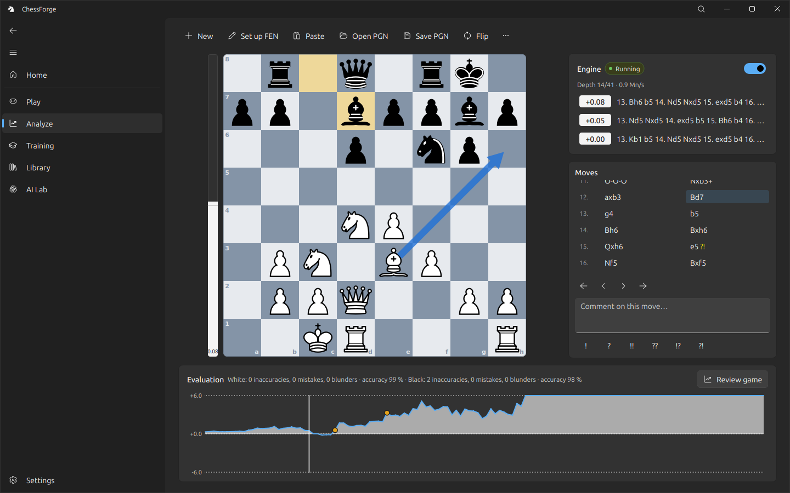
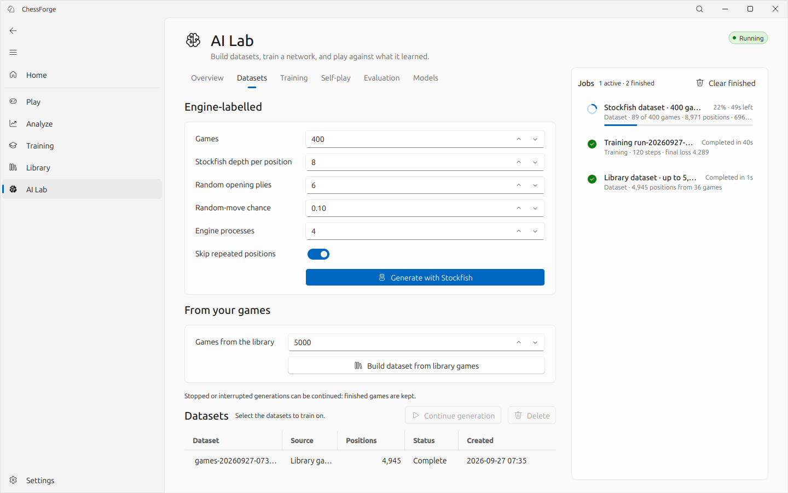
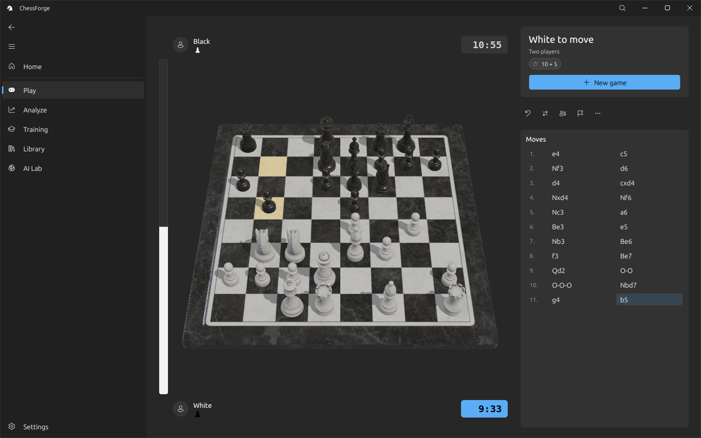

# ChessForge

**A local chess workstation for Windows and Linux: play and analyse with Stockfish, train with puzzles and drills,
keep a game library, and train your own neural network.** Built with [FluentQt](https://github.com/pntrungbk15/fluentqt-showcase)
on PyQt5.


> **About this repository.** It presents ChessForge through screenshots and a written overview. It contains no source
> code: the application's source is private at this stage.



| At a glance | |
|---|---|
| **What** | An independent desktop application: play, analysis, training, a game database and a neural-network lab in one tool that runs locally. |
| **Engine integration** | Stockfish over UCI in its own processes; live multi-line analysis; background game review with an evaluation graph, critical moments and accuracy. |
| **AI Lab** | Datasets from your games or from Stockfish, a policy/value network trained with PyTorch in a separate process, MCTS self-play, checkpoint evaluation, and play against your own models. |
| **Data** | A local SQLite library with background PGN import, search, filters, tags, collections and duplicate detection. |
| **Packaging** | A standalone build compiled with Nuitka and verified by launching it; Stockfish is detected or downloaded, never bundled. |

## Features

| Area | What it does |
|---|---|
| **Play** | Against Stockfish (levels 0–20), a friend, a model trained in the AI Lab, or engine against engine; clocks with increment, any FEN start, draws, takebacks, rematch. |
| **Analysis** | Live multi-line analysis with the best move drawn as an arrow; **Review game** grades every move in the background and marks the critical moments. |
| **Training** | 2,475 puzzles by theme and rating band, SM-2 spaced repetition of missed puzzles, 3,815 named opening lines to drill, endgame drills against Stockfish. |
| **AI Lab** | Stockfish datasets generated by several engine processes in parallel, skipping repeated positions and committed in chunks, so a stopped or crashed run resumes where it left off. Every job sits in a persistent queue with progress, pause, resume, cancel and retry. |
| **Board** | A 2D board with seven themes and an optional OpenGL 3D board; drag, click or keyboard play; right-drag arrows. |
| **Commands** | Ctrl+K opens a command palette for every frequent action. |
| **Accessibility** | Full keyboard play, reduced motion, a high-contrast board, text scaling, light/dark/system theme. |

## Screens

| | |
|---|---|
|  |  |
| **Home:** today's puzzle, recent games, training progress, engine readiness. | **Play:** clocks, move list, captured material and an evaluation bar. |
|  |  |
| **Analysis:** live Stockfish lines and a reviewed game. | **Training:** puzzles by theme and rating with hints and progress. |
|  |  |
| **Library:** filters, search, tags, collections and a preview (demo players are fictional). | **AI Lab:** a training run with live losses, accuracy and throughput. |
|  |  |
| **Datasets:** a Stockfish generation running in the job queue. | **Ctrl+K:** the command palette. |



## Architecture

```
app           main window, lazily built pages, cross-page actions
game/         game model (PGN tree + cursor), clocks, play controller
engine/       UCI protocol, one process per engine, detection and probing
analysis/     background game review
rendering/    board view, 2D renderer, OpenGL 3D renderer, themes
storage/      SQLite schema and repositories (games, collections, runs, training)
training/     puzzle, opening and endgame catalogues, drills, rating, SM-2
ai/           training process and controller, network, MCTS, datasets
ui/           pages and widgets (FluentQt)
```

The GUI never waits on an engine or on training: Stockfish runs in its own processes and training in a separate Python
process, both reporting progress through throttled updates.

## Performance

Measured with the project's benchmark scripts (medians):

| Measurement | Result |
|---|---|
| Cold start to first paint | 183 ms |
| Import 10,000 PGN games | 295 ms, worst GUI stall 20 ms |
| Library page at 100,000 games | 1.1 ms (text search 23 ms) |
| Stockfish dataset, depth 8, 4 engine processes through the job queue | 1,119 positions/s, worst GUI stall 17 ms |
| 3D drag on Intel Iris Xe | 16.7 ms per frame (vsync), 1.2 ms CPU |

## Author

Phạm Ngọc Trung · [github.com/pntrungbk15](https://github.com/pntrungbk15)

All screenshots © Phạm Ngọc Trung. Shown here for portfolio purposes; no licence to the software is granted by this
repository.
