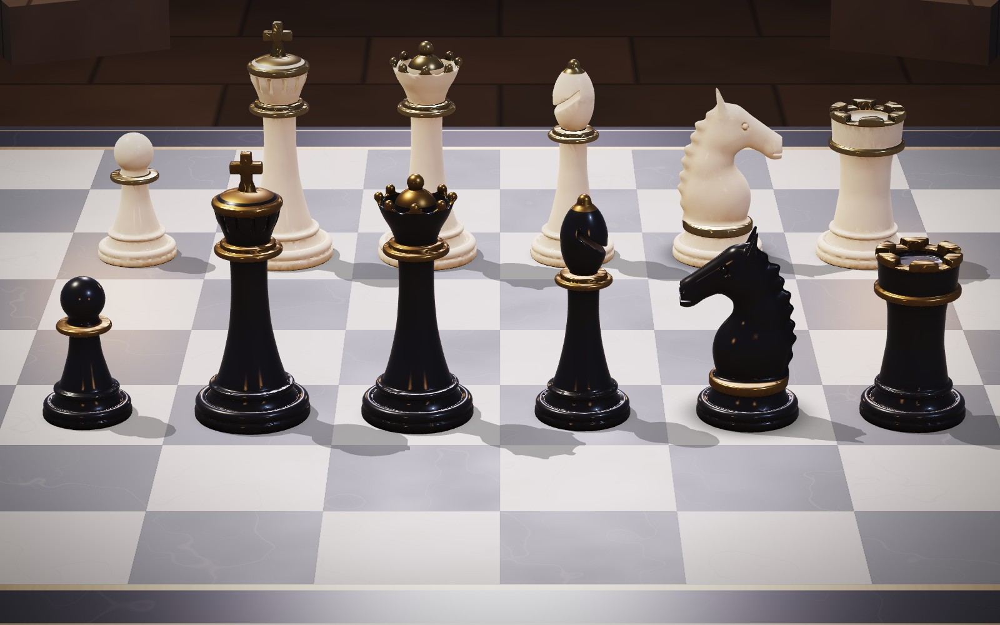
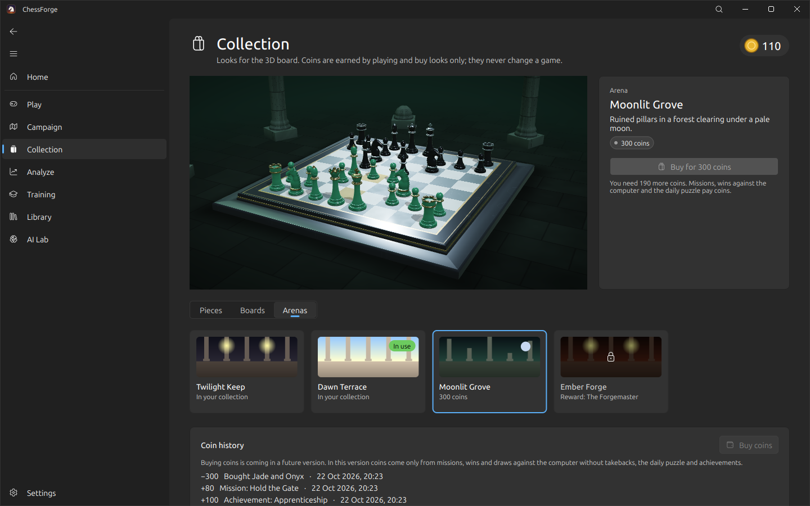
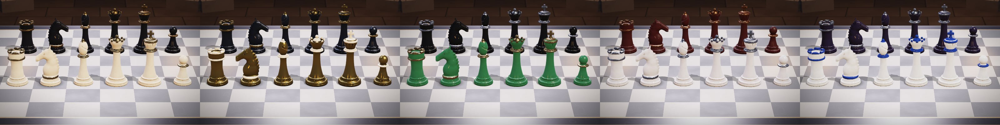

# ChessForge

**A 3D chess game and chess workstation for Windows and Linux.**
- Play on a sculpted ivory-and-obsidian set in a torchlit royal hall, or follow a twelve-mission campaign.
- Collect piece, board and arena looks with coins earned in play.
- Analyse with Stockfish, train with puzzles and drills, keep a game library, and train your own neural network.

Built with [FluentQt](https://github.com/pntrungbk15/fluentqt-showcase) on PyQt5.


> **About this repository.** It presents ChessForge through screenshots and a written overview. It contains no source
> code: the application's source is private at this stage.


| At a glance | |
|---|---|
| **What** | An independent desktop application: a 3D chess game with a campaign and a cosmetic collection, plus analysis, training, a game database and a neural-network lab, all running locally. |
| **3D** | A custom OpenGL 2.1 renderer and an original sculpted chess set (signed distance functions meshed and baked by a build script); physically based, fully procedural materials with no textures; planar and contact shadows; four halls; a camera you can orbit and zoom while picking stays exact. |
| **Progression** | Twelve missions judged move by move; a coin ledger whose rows are keyed by the event they pay for, so nothing is paid twice; purchases in one transaction. Coins buy looks only, and there is no way to buy coins in this version. |
| **Engine integration** | Stockfish over UCI in its own processes; live multi-line analysis; background game review with an evaluation graph, critical moments and accuracy. |
| **AI Lab** | Datasets from your games or from Stockfish, a policy/value network trained with PyTorch in a separate process, MCTS self-play, checkpoint evaluation, and play against your own models. |
| **Data** | A local SQLite library with background PGN import, search, filters, tags, collections and duplicate detection. |
| **Packaging** | A standalone Windows build compiled with Nuitka and verified by launching it, packed into a per-user Inno Setup installer; Stockfish is detected or downloaded, never bundled. |

## Features

| Area | What it does |
|---|---|
| **3D board** | On by default with hardware OpenGL: glazed ivory with champagne gold against polished obsidian with antique gold, a veined marble board with a brass inlay on a dais, in a hall of pillars, arches, moonlit windows and torches. Drag outside the squares to turn it, wheel to zoom, C to reset; the camera never moves by itself. A detail setting drops the hall on older graphics. |
| **Campaign** | Three chapters against named opponents, from a built-in sparring engine to Stockfish level 11; goals are win, do not lose, or hold out for a number of moves; rewards are paid once. |
| **Collection** | Five piece finishes, five boards and four arenas, previewed live on the 3D board and listed in a FluentQt Pro `CatalogView`; coins come from missions, wins and draws against the computer, the daily puzzle and achievements. |
| **Play** | Against Stockfish (levels 0–20), the built-in sparring partner (no download), a friend, a model trained in the AI Lab, or engine against engine; clocks with increment, any FEN start, draws, takebacks, rematch. |
| **Analysis** | Live multi-line analysis with the best move drawn as an arrow; **Review game** grades every move in the background and marks the critical moments. |
| **Training** | 2,475 puzzles by theme and rating band, SM-2 spaced repetition of missed puzzles, 3,815 named opening lines to drill, endgame drills against Stockfish. |
| **AI Lab** | Stockfish datasets generated by several engine processes in parallel, skipping repeated positions and committed in chunks, so a stopped or crashed run resumes where it left off. Every job sits in a persistent queue with progress, pause, resume, cancel and retry. |
| **Board** | A 2D board with seven themes where 3D is unavailable and in training; drag, click or keyboard play; right-drag arrows. |
| **Desktop** | A splash screen with the real loading steps and Retry on failure; a system tray icon with Open/Hide, New game, Continue the campaign and Quit. |
| **Commands** | Ctrl+K opens a command palette for every frequent action. |
| **Accessibility** | Full keyboard play, reduced motion, a high-contrast board, text scaling, light/dark/system theme. |

## The 3D board


| | |
|---|---|
|  |  |
| The default view in play: a 40° camera with the whole board, the frame and the hall beyond it. | All six piece types from White's side: the knight in profile, the bishop's cut, the queen's crown of pearls, the king's cross. |
|  |  |
| The same line-up from Black's side: obsidian with antique gold. | A selected knight's legal moves, the last move and the selection stay legible on light and dark squares. |
|  |  |
| The camera after the player turned it: it stays wherever it is put. | The Collection previews a look on the live 3D board before it is bought. |




Rendered by the application's own renderer at the shader quality it uses on a GPU.

## Screens

| | |
|---|---|
|  |  |
| **Home:** the next campaign mission first, then quick actions, recent games and training progress. | **Campaign:** chapters, the mission briefing and achievements. |
|  |  |
| **Collection:** a look previewed on the live 3D board, the looks in a catalog grid, coin history; buying coins is not offered. | **Play:** clocks, move list, captured material and an evaluation bar (2D board). |
|  |  |
| **Analysis:** live Stockfish lines and a reviewed game. | **Training:** puzzles by theme and rating with hints and progress. |
|  |  |
| **Library:** filters, search, tags, collections and a preview (demo players are fictional). | **AI Lab:** a training run with live losses, accuracy and throughput. |
|  |  |
| **Datasets:** a Stockfish generation running in the job queue. | **Ctrl+K:** the command palette. |

Game-page screenshots use demo progress.

## Architecture

```
app           main window, lazily built pages, cross-page actions
game/         game model (PGN tree + cursor), clocks, play controller
engine/       UCI protocol, one process per engine, detection and probing, a built-in sparring engine
progression/  campaign missions and their judge, coin ledger, collection, achievements
analysis/     background game review
rendering/    board view and camera, 2D renderer, OpenGL 3D renderer, the sculpted set, board and halls, finishes
storage/      SQLite schema and repositories (games, collections, runs, training)
training/     puzzle, opening and endgame catalogues, drills, rating, SM-2
ai/           training process and controller, network, MCTS, datasets
ui/           pages and widgets (FluentQt)
```

The GUI never waits on an engine or on training: Stockfish runs in its own processes and training in a separate Python
process, both reporting progress through throttled updates.

## Performance

Measured with the project's benchmark scripts (medians):

| Measurement | Result |
|---|---|
| Import 10,000 PGN games | 295 ms, worst GUI stall 20 ms |
| Library page at 100,000 games | 1.1 ms (text search 23 ms) |
| Stockfish dataset, depth 8, 4 engine processes through the job queue | 1,119 positions/s, worst GUI stall 17 ms |
| 3D drag on Intel Iris Xe | 16.7 ms per frame (vsync, the display rate) |

## Availability

There is no public download at this stage. The Windows build (a standalone Nuitka folder packed into a per-user Inno
Setup installer, `ChessForge-<version>-Setup.exe`) is produced and tested privately; it needs Windows 10 or 11 (64-bit)
and, for the 3D board, hardware OpenGL 2.1 such as Intel Iris Xe or any recent GPU.

## Not in this version

Online multiplayer (local two-player only), buying coins (disabled and labelled as a future feature), and playtested
difficulty for the campaign.

## Author

Phạm Ngọc Trung · [github.com/pntrungbk15](https://github.com/pntrungbk15)

All screenshots © Phạm Ngọc Trung. Shown here for portfolio purposes; no licence to the software is granted by this
repository.
